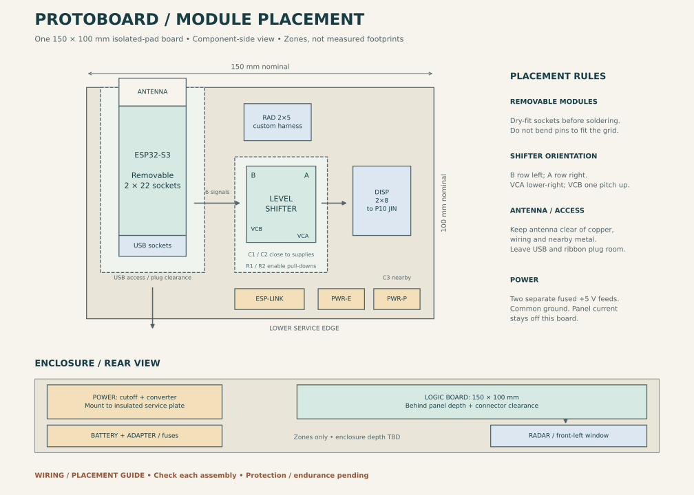
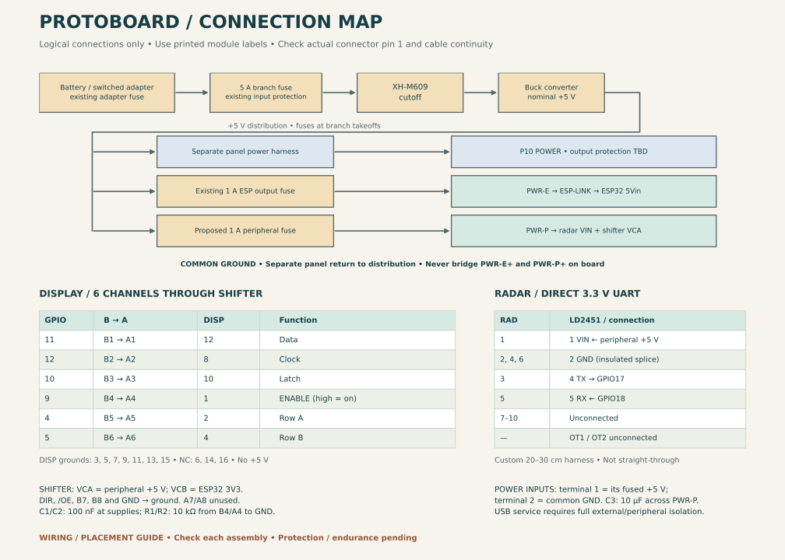

# Protoboard assembly — placement and wiring guide

Use one **150 × 100 mm FR4 board with
2.54 mm isolated pads**, removable ESP32 and shifter modules, and a remote
radar. Cutoff, converter, fuses and panel-power distribution mount separately.
The one-panel firmware and GPIO allocation remain unchanged.

**Placement zones, not a hole-by-hole soldering template.** The assembled
prototype passed reported startup/walking checks and a five-minute functional run.
Match socket fit and connector keying on each build; final protection, prolonged
operation and measured thermal checks remain open. See [validation](../../docs/validation.md).

## Drawings and board selection

- [Component placement and enclosure arrangement](placement.svg)
- [Power branches and signal connection map](connections.svg)
- [Parts and purchasing checklist](bom.md)



Choose individual isolated pads, not continuous copper strips or breadboard
groups. Plated-through pads are convenient for sockets and underside wiring.
Verify socket/terminal tails fit the actual holes; pitch alone does not establish
fit. Board dimensions are nominal; measure the purchased board and usable area.

The component-side view has the 150 mm edge horizontal. Reserve these zones;
they are not drilling coordinates or measured module outlines:

| Area | Position and reservation | Orientation / access |
| --- | --- | --- |
| ESP32 | Left; approximately 45 × 80 mm including service space | Antenna toward/over the upper edge; USB toward lower service edge |
| Shifter | Centre; approximately 40 × 50 mm including supporting parts | B row left, A row right; VCA at lower-right |
| RAD connector | Upper edge, right of ESP32 | Keyed 2×5, room for plug and ribbon bend |
| DISP connector | Right of shifter | Keyed 2×8; short clock/data connections |
| Capacitors / pull-downs | Beside relevant shifter terminals | Keep capacitor connections short |
| ESP-LINK | Lower centre | Accessible removable external-power shunt |
| PWR-E / PWR-P | Lower-right service edge | Separate, clearly labelled 2-position power terminals |

The ESP32 uses two 1×22 sockets. The shifter uses one 1×12 and one 1×10;
its shorter B row is inset by one pitch at both ends. In this drawing's
orientation, VCB is at the bottom of the left row, one pitch above VCA.
Match actual printed labels before wiring.

Confirmed header-row centres are **25.40 mm for the ESP32 and 15.24 mm for the
shifter**, with 2.54 mm pitch. These supersede the earlier estimates. Measure your
boards and dry-fit without forcing pins. Support and insulate all sockets and
module undersides; the drawing does not establish manufacturing tolerances.

Use standoffs, an insulating underside cover and cable strain relief. Keep pads,
wires and metal away from the antenna; arrange its antenna section to overhang
the board edge. The drawing does not define a verified RF clearance. Leave room
for socket height, underside parts, module extraction and inserted USB plugs.

## Enclosure arrangement

Viewed from the rear, put power hardware on the left and this board on the
right, behind the panel's depth and connector clearance. The radar is at the
lower-right in this view: **front-left when facing the sign from the street**.
Keep its antenna path clear. Battery/adapter sit low on the opposite side.

Mount the XH-M609 and converter directly to the insulated service plate using
suitable supports; neither needs another protoboard. Keep cutoff controls and
fuses reachable, and leave the converter exposed to circulating air. Confirm
actual module envelopes and temperature behaviour before fixing enclosure depth.
Enclosure fabrication and weather protection remain outside this package.

## Display wiring

These names identify **module silkscreen labels**. Match the actual labelled
contacts; these connections preserve the recorded bench mapping.

| ESP32 GPIO | Shifter input | Shifter output | DISP contact | Function |
| --- | --- | --- | ---: | --- |
| 11 | B1 | A1 | 12 | Data |
| 12 | B2 | A2 | 8 | Clock |
| 10 | B3 | A3 | 10 | Latch |
| 9 | B4 | A4 | 1 | Panel ENABLE; high enables this panel |
| 4 | B5 | A5 | 2 | Row A |
| 5 | B6 | A6 | 4 | Row B |
| GND | — | — | 3, 5, 7, 9, 11, 13, 15 | Signal ground |

Leave DISP **6, 14 and 16 unconnected**. No +5 V enters DISP. Panel power uses
its separate harness. This is the recorded panel/cable mapping, not a universal
HUB12 pinout. Preserve the existing cable to the panel's **JIN**, not JOUT.

Both board IDC headers use this component-side convention, after rotating the
actual part to match its marked pin 1. Do not assume a notch position from this
diagram; check the manufacturer's drawing and completed cable continuity.

```text
DISP 2×8          RAD 2×5
 1   2             1   2
 3   4             3   4
 5   6             5   6
 7   8             7   8
 9  10             9  10
11  12
13  14
15  16
```

The underside and mating-face views are mirrored. Mark pin 1 on both the board
and harness; verify every conductor unplugged at both ends.

## Shifter, power link and supporting parts

| Part / terminal | Connection |
| --- | --- |
| Shifter VCA | PWR-P terminal 1, peripheral +5 V |
| Shifter VCB | ESP32 3V3 |
| Both shifter GND labels | Common ground |
| Shifter DIR and /OE | Common ground; fixed B-to-A operation |
| Shifter B7, B8 | Common ground |
| Shifter A7, A8 | Leave unconnected |
| C1, 100 nF | VCA to GND, close to module |
| C2, 100 nF | VCB to GND, close to module |
| C3, 10 µF | Positive to PWR-P:1; negative to GND |
| R1, 10 kΩ | B4 to GND |
| R2, 10 kΩ | A4 to GND |
| ESP-LINK:1 | PWR-E:1, fused ESP +5 V |
| ESP-LINK:2 | ESP32 5Vin |
| ESP32 GND | Common ground |

Keep all other unused ESP32 GPIO contacts unconnected. Connect using the board's
printed 3V3, 5Vin and GND labels; do not substitute similarly positioned pins
from another ESP32 variant. See the [hardware overview](../../docs/hardware.md).

TI specifies VCCA on the 5 V side, VCCB on the 3.3 V side, and DIR low with /OE
low for B-to-A transmission. /OE enables the **shifter**; the separate B4/A4
signal enables the **panel**. Pull-downs bias panel enable low when undriven;
they do not establish verified startup blanking. The actual breakout's routing
and any jumpers must agree with these connections.

## Radar harness

Use a keyed 2×5 board connector and a custom, initially **20–30 cm** ribbon
harness to a suitable 1×6 female housing at the radar. This is not a
straight-through 10-to-6 adapter. Label and strain-relieve both ends.

| RAD contact | Board-side net | Radar-end connection |
| --- | --- | --- |
| 1 | PWR-P:1, peripheral +5 V | LD2451 pin 1 VIN |
| 2, 4, 6 | Common ground | Join in an insulated splice to pin 2 GND |
| 3 | ESP32 GPIO17 (UART RX) | Pin 4 TX |
| 5 | ESP32 GPIO18 (UART TX) | Pin 5 RX |
| 7–10 | Unconnected | Insulate unused conductors individually |

Radar pins 3 OT1 and 6 OT2 remain unconnected. In the manual's upright,
antenna-side view, the top header reads VIN, GND, OT1, TX, RX, OT2 left to right.
Confirm actual silkscreen. Radar UART is 3.3 V logic and bypasses the shifter.
The map reserves both UART directions; installed continuous firmware is
receive-only and this guide does not request radar configuration changes.
Disconnect the USB radar adapter electrically for battery operation.

## Power distribution



Battery/switched adapter → existing 5 A branch fuse → XH-M609 → converter.
Retain the adapter's existing supplied fuse; it does not replace the 5 A branch
fuse. Match cutoff IN+/IN− and OUT+/OUT− labels on the actual board. Converter
input is red positive / input black negative; output is yellow positive /
output black negative. Keep input and output returns on their designated leads.

At the converter output, use secured, insulated distribution connections:

| Branch | Destination / protection |
| --- | --- |
| Panel | Existing separate power harness and return; final output protection remains a power-validation item |
| ESP | Recorded 1 A output fuse → PWR-E:1 → ESP-LINK → 5Vin |
| Peripheral | Proposed 1 A output fuse → PWR-P:1 → radar VIN and shifter VCA |
| Returns | PWR-E:2 and PWR-P:2 are common ground; connect to converter output ground |

**Never join PWR-E:1 to PWR-P:1 on the board.** They share the converter source
upstream of separate fuses, but their downstream positive nets remain separate.
ESP32 3V3 supplies shifter VCB. Panel current must not flow through protoboard
ground wiring, the ESP32, or the signal ribbon; give the panel its own return
to the distribution point while retaining common signal ground.

Install both output fuses at the takeoffs, before thinner conductors. Use short
22 AWG copper logic-power wiring and compatible insulated terminals; use
24–26 AWG insulated signal wires. Use wired connections rather than long
solder-bridge power buses. Select radar ribbon, splices and connectors compatible
with their protected branch; signal-wire guidance is not a rating for radar
power conductors. The 1 A peripheral fuse is a provisional starting selection,
not measured load compatibility or guaranteed semiconductor protection. Do not
increase it automatically if it opens.

The existing converter was measured around 5.15–5.17 V. Earlier successful
operation does not establish the radar's unspecified supply tolerance or qualify
the new wiring. Retain that uncertainty and measure loaded rails during assembly
commissioning. Battery cutoff settings remain 18.0 V / 2.0 V hysteresis;
actual trip/reconnect, thermal behaviour and final panel protection remain open.

## Assembly and commissioning checklist

Use a fresh checklist for each assembly. Unchecked boxes are builder actions,
not a claim that no prototype checks have been completed; see the dated validation summary.

- [ ] Dry-fit sockets, headers, standoffs, cover and inserted plugs; no forced pins.
- [ ] Label board component side, every connector, pin 1 and both positive feeds.
- [ ] With all supplies and modules removed, verify each connection in the tables.
- [ ] Check adjacent-pad isolation, NC contacts and no short between supply rails
  or to ground. Check ESP-LINK continuity both fitted and removed.
- [ ] Check PWR-E/PWR-P positive isolation with both feed cables disconnected
  from distribution; upstream common +5 V otherwise defeats this test.
- [ ] Verify every IDC conductor to the intended far-end contact, including
  grounds and unused wires; check C3 polarity and terminal clamping.
- [ ] Inspect insulation, retention, underside clearance, and wire strain relief.
- [ ] Commission with the established staged bench procedure: supply checks,
  controller, shifter, radar, then panel. Rewire only with all power removed;
  avoid driving an unpowered peripheral during isolated stages.
- [ ] Measure loaded 5 V and 3.3 V, observe startup and reset blanking, and check
  correct speed/warning rendering and clearing when radar reports stop.
- [ ] Repeat attended run and temperature checks after the wiring transfer;
  record actual readings and observations in hardware/validation notes.

For USB programming, use the established isolated setup: battery removed,
external ESP32 power/header connections disconnected, panel power/JIN disconnected,
radar adapter disconnected, COM USB only. Remove ESP-LINK as well. The link alone
does not establish USB isolation or prevent peripheral backfeed. Restore all
battery-operation connections only after USB and battery are disconnected.

## Evidence and editable sources

See [validation](../../docs/validation.md) for completed observations and
[primary references](../../docs/references.md) for the TI function table, LD2451
header/power specifications and fuse documentation. Board/cable continuity checks
remain essential; the chip datasheet does not establish breakout routing.

`draw_layout.py` regenerates the SVG diagrams and ignored PNG previews under
`output/protoboard/`. It creates no board holes, copper tracks or fabrication files.
Run from the repository root in the Python environment used for development:

```sh
python -m pip install -r hardware/protoboard/requirements.txt
python hardware/protoboard/draw_layout.py
```
